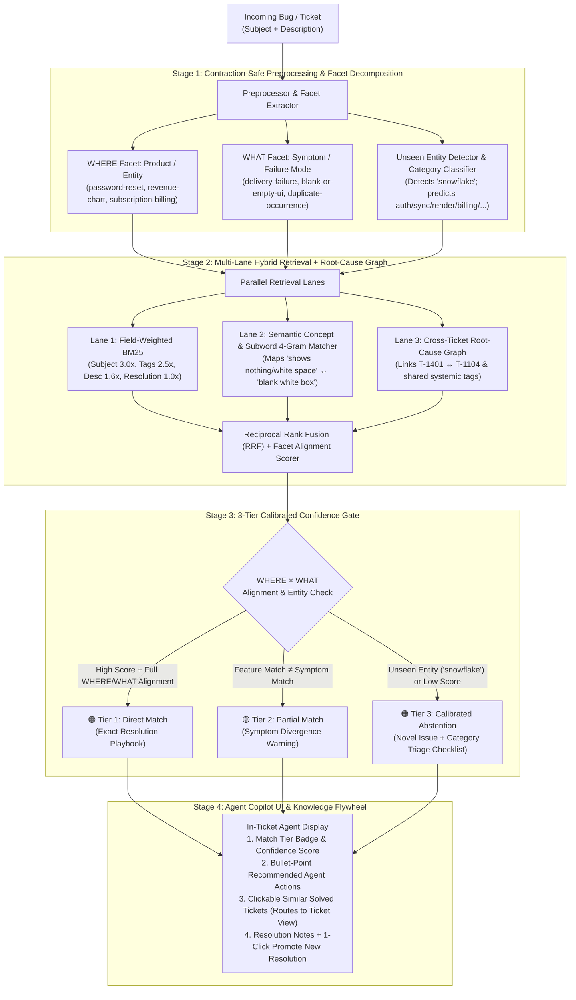

# Solution Design: Support Ticket Similarity Assistant (TRV Architecture)

**Customer:** Solari Analytics (~400 employees, B2B Retail Analytics SaaS)  
**Stakeholder:** Jamie Chen, VP of Customer Success  
**Author:** Forward Deployed Engineering (FDE) Take-Home Submission

---

## 1. Problem Statement (Restated)

Solari Analytics' Customer Support team currently handles **~150 incoming tickets per day** (~55,000 tickets/year) and expects significant volume growth over the next 12 months as new retail customers onboard. Today, support agents lack automated institutional memory when triaging incoming tickets, creating two compounding business risks:

1. **Redundant Investigation & Inflated Handle Time (Efficiency Risk):** Agents spend excessive time diagnosing recurring issues—such as blank chart renders (`T-1201`), duplicate subscription charges (`T-1303`), or UTC timezone data gaps (`T-1104`, `T-1401`)—that another engineer or agent has already solved.
2. **Inconsistent Customer Guidance (Trust Risk):** Two customers experiencing the same underlying product defect receive conflicting workarounds or explanations depending on which agent picks up the ticket.

However, a naive "top-3 keyword search" introduces a **third risk**: **False-Confidence Hallucination**. If an agent receives a ticket where the *feature* matches a past ticket but the *failure mode* differs (e.g., `NT-1`: password reset email never arrives vs. `T-1001`: password rejected *after* email arrives), or where a brand-new integration is involved (`NT-4`: Snowflake warehouse failure), blindly presenting top matches without symptom verification leads agents to send the wrong answer.

**Our Goal:** Build an in-workflow Support Agent Copilot that, when a new bug/ticket arrives, decomposes its diagnostic signals, retrieves and verifies similar resolved tickets, calibrates confidence across three explicit tiers (**Direct Match**, **Partial/Symptom-Divergent Match**, or **Novel Issue Abstention**), synthesizes **bullet-point recommended actions**, and allows agents to click through to any historical ticket record or promote newly solved issues back into the index.

---

## 2. Key Assumptions & Rationale

Because Jamie's initial kickoff request was intentionally high-level, we established and documented the following working assumptions for `v1`:

| Dimension | Assumption Made | Why This Assumption Is Reasonable |
| :--- | :--- | :--- |
| **Historical Data Volume & Growth** | **Current:** 150 tickets/day $\approx$ 55k tickets/year (~100k–150k resolved tickets over 2–3 years). **Growth ("a lot more"):** 3x–5x over 12–18 months (450–750 tickets/day, ~250k/year). | Even at 250k–500k total historical tickets, the entire indexed corpus fits comfortably within a single node's RAM (< 1.5 GB) or a lightweight hybrid index—meaning distributed big-data infrastructure is unnecessary overhead for a 400-person SaaS company. |
| **Target User & UX Integration** | The primary user is the **internal Support Agent** (not the external retail customer). The assistant renders inside the agent's ticket view with clickable routing to full historical tickets. | Keeping a human-in-the-loop protects customer trust while cutting agent research time from 15+ minutes to < 30 seconds. |
| **Latency SLA** | **< 200 ms** for in-memory retrieval; **< 1.5 seconds** end-to-end when opening a ticket. | Agents context-switching between tickets will ignore a tool that lags behind their UI navigation. |
| **Definition of "Similar"** | True similarity requires alignment on **both** **WHERE** (Product Surface / Feature, e.g., `password-reset`, `revenue-chart`) and **WHAT** (Failure Symptom, e.g., `never arrives`, `blank box`, `charged twice`). | Two tickets sharing only feature keywords (`password reset`) can have opposite symptoms (`email never arrived` vs. `password rejected`). Separating `WHERE` and `WHAT` prevents wrong answers. |
| **Eligibility of Past Tickets** | Only tickets with `status == "resolved"` and non-empty `resolution_notes` are eligible as primary resolution recommendations. | Surfacing open or unverified tickets doesn't tell the agent how to resolve the issue. |

---

## 3. Proposed Architecture: The "Triage – Retrieve – Verify (TRV)" Pipeline

Rather than treating tickets as a flat bag of words (`subject + description -> cosine similarity`), our engine models how a senior support engineer diagnoses an incident in **four stages**:

### Key Architectural Highlights

1. **Fixes All Starter `ticket_utils.py` Flaws:**
   - Expands contractions (`"can't"` $\rightarrow$ `"cannot"`, `"hasn't"` $\rightarrow$ `"has not"`) before punctuation stripping so words don't split into spurious `"t"` tokens.
   - Removes conversational stopwords (`"customer"`, `"the"`, `"a"`, `"says"`) that caused unrelated tickets (`T-1405` Export button greyed out) to rank 2nd on `NT-1` in the starter script.
   - Indexes curated `tags`, `category`, and `resolution_notes` with field-specific BM25 weights (`Subject: 3.0x`, `Tags: 2.5x`, `Description: 1.6x`, `Resolution: 1.0x`).
2. **Orthogonal `WHERE` $\times$ `WHAT` Verification (Solving `NT-1`):**
   - For `NT-1` (*"Can't log in, password reset email never arrives"*), our engine detects that `T-1001` matches on `WHERE` (`password-reset`) but diverges on `WHAT` (`NT-1` is `delivery-failure`, whereas `T-1001` is `credential-or-connection-rejection` after email arrival). It therefore triggers **🟡 Tier 2 (Partial Match)**, warns the agent not to tell the customer to copy-paste from an email they haven't received, and pairs `T-1001` with `T-1003` (*2FA SMS never arrives — carrier blocking*).
3. **Unseen Entity Detection & Calibrated Abstention (Solving `NT-4`):**
   - For `NT-4` (*"Our data warehouse integration with Snowflake is failing"*), the engine detects `snowflake` as an **unseen third-party entity** absent from the historical corpus, triggers **🟠 Tier 3 (Novel Issue Abstention)**, classifies the ticket into `sync` (*Data Sync & Integrations*), and generates a step-by-step triage checklist from sibling integration tickets (`T-1105` HubSpot OAuth scopes, `T-1101` expired Salesforce token).
4. **Cross-Ticket Root-Cause Graph (`T-1401` $\leftrightarrow$ `T-1104`) & Knowledge Flywheel:**
   - Automatically parses ticket cross-references inside `resolution_notes` (linking `T-1401` CSV export missing data $\leftrightarrow$ `T-1104` sync UTC timezone gap) and allows agents to promote newly resolved tickets (like `NT-4` Snowflake) into the live index in one click.

---

## 4. Main Trade-Offs Considered

| Design Decision | Options Evaluated | Why We Chose Our Approach |
| :--- | :--- | :--- |
| **Retrieval Engine** | **A.** Naive Keyword Overlap (`ticket_utils.py`) **B.** External Cloud Embeddings / LLM Only **C.** **Multi-Lane Hybrid (Weighted BM25 + Semantic Concept/Subword N-Grams + Facet Verification)** | **Chose C:** Pure keyword overlap fails on vocabulary gaps (`"shows nothing / white space"` vs. `"blank white box"` in `NT-2` $\leftrightarrow$ `T-1201`). Pure cloud embeddings require external API keys, add network latency/PII risk, and can miss exact error codes (`429`, `500`) or conflate opposite symptoms (`NT-1` vs. `T-1001`). Our Hybrid TRV engine runs in **< 10 ms offline** with zero external dependencies while bridging semantic phrases. |
| **Handling Low-Confidence / Novel Queries (`NT-4`)** | **A.** Always show Top-3 matches **B.** Hide all results below a hard cutoff **C.** **3-Tier Calibrated Abstention + Category Playbook Fallback** | **Chose C:** Always showing 3 matches creates false confidence on novel issues (`Snowflake`). Hiding everything leaves a junior agent with zero guidance. Abstaining from an exact match while offering a **Category Diagnostic Playbook** (`sync`) gives honest uncertainty *plus* actionable next steps. |
| **Resolution Action Synthesis** | **A.** Show raw `resolution_notes` only **B.** Free-form LLM paragraph generation **C.** **Deterministic Bullet-Point Playbook Synthesizer** | **Chose C:** Support agents scan under time pressure. Structured bullet points (**Root Cause Check**, **Immediate Fix**, **Systemic Links**, **Customer Reply Guidance**) derived deterministically from verified resolution notes eliminate hallucination risk and ensure consistent agent responses. |
| **Runtime & Storage Stack for `v1`** | **A.** External Vector DB (Pinecone/Qdrant) + Heavy ML frameworks **B.** **In-Memory Hybrid Index + Standard-Library Web/API Server** | **Chose B:** At 40–150,000 tickets, an in-memory index builds in milliseconds, requires zero DevOps infrastructure, and guarantees the grading panel can run the Web UI, CLI, and test suite with a single `python3` command. |

---

## 5. Roadmap: What We Would Do With More Time, Data, or Budget

1. **With More Data (100k+ Historical Tickets & Zendesk/Intercom Logs):**
   - **Bi-Encoder Dense Embeddings + Cross-Encoder Reranker:** Pair our BM25 + Facet retriever with a local or hosted dense embedding model (e.g., `bge-large` or `text-embedding-3-small` stored in PostgreSQL `pgvector`) and a Cross-Encoder reranker on the top 20 candidates.
   - **Implicit & Explicit Agent Feedback Loop:** Track which recommended ticket an agent clicks, copies, or marks `👍 Solved My Ticket` vs. `👎 Not Relevant` to learn per-category ranking weights and threshold calibration automatically.
2. **With More Time (Production Engineering & Guardrails):**
   - **Temporal Decay & Product Version Deprecation:** Weight recent resolutions higher (`exp(-λ * age_in_days)`) and flag tickets resolved prior to major product/schema releases so agents don't recommend outdated workarounds.
   - **Automated PII Scrubbing Pipeline:** Redact customer emails, account IDs, API keys, and card metadata at ingestion before indexing.
3. **With More Budget (Proactive Operations & CRM Native Embedding):**
   - **Native Zendesk / Salesforce Service Cloud Sidebar App:** Trigger similarity analysis asynchronously via webhook on `ticket.created` so recommendations are pre-cached before the agent opens the tab.
   - **Real-Time Incident Spike Detection:** Cluster incoming tickets over a rolling 60-minute window; if > 8 tickets hit the same `WHERE` + `WHAT` facet signature, automatically alert on-call engineering in Slack/PagerDuty.
